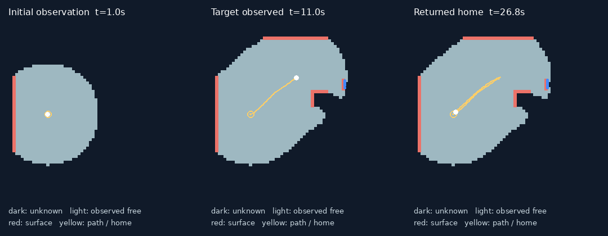

# 未知配置の対象探索と帰還 — 検証記録

2026-10-24、Ubuntu 24.04 / WSL2、Python 3.12.12、MuJoCo 3.3.7で実行。
探索・物理実装を `5d28829` で固定してから、未使用の配置を評価した。

## 実装した課題

「青／緑の対象を探し、発見したら出発地点へ戻る」。対象が見つからない場合も帰還する。
障害物と対象はシードから配置し、同じ指示のまま配置を変えて実行できる。
地図、シード、対象の正解座標、手書きの迂回地点を探索プログラムやCodexへ渡さない。

Codex CLIは指示から対象色・総時間制限・帰還方針のJSONを生成する。
地図作成と移動先の選択は従来型のアルゴリズムで行う。LLMに幾何計算や関節制御を任せてはいない。

探索の入力は自己位置・向き・速度・時刻と、1 Hzの距離／表面色スキャンだけ。
MuJoCoの [mj_ray](https://mujoco.readthedocs.io/en/3.3.7/APIreference/APIfunctions.html#mj-ray) を使い、
高さ0.3 m、360度、2度刻み、最大1.8 mで最初に当たる面を取得する。
レイの先にある物体の名前や位置は返さない。色は可視面のRGBAから判定する理想センサーで、カメラ認識ではない。
自己位置はシミュレータの正解値を使う。

0.1 m格子へ観測を蓄積し、未知領域が見えそうな場所を選ぶ。
既知の壁の裏を情報利得に数えず、未観測の領域に機体を入れる経路は作らない。
観測済みの占有セルを0.58 m膨張させ、Dijkstra法で到達経路を求める。
実測位置の丸め誤差には隣接する安全セルへの回復を許し、障害物の近くでは減速する。
速度指令は0.2秒単位、前進最大0.25 m/s、旋回最大0.6 rad/s。関節・接地は既存のMoE方策とMuJoCoが制御する。

指定色が2本以上のレイで観測されたら発見とし、帰還する。対象への接近・回収は行わない。
帰還の予備時間を残して探索を打ち切る。`not_found` は未発見という結果であり、不在の証明ではない。

正解の障害物情報はシミュレータ内の安全停止と評価用トレースで使用する。
探索の観測へ正解情報を返さず、安全停止から探索を再開して位置を推測する処理もない。

## 最終版の未見配置評価

実験条件は [search-evaluation.json](search-evaluation.json)、計画・ソースSHA-256・全結果は
[search-validation.json](search-validation.json) に保存した。
実際のCodexを色ごとに1回呼び、得られた計画を全配置で共用した。
青の指示と「青ではなく緑」という指示の両方が正しく解釈された。応答待ちはそれぞれ7.37秒、7.31秒だった。

各条件1回。対象あり6配置×2色と、青が存在しない別の2配置、合計14条件を全て実行した。
全条件で最初の観測には要求色がなく、移動によって初めて観測する必要があった。

| 配置シード | 青：発見・帰還 | 緑：発見・帰還 |
| --- | --- | --- |
| 501 | 成功・29.8秒 | 成功・78.0秒 |
| 502 | 成功・47.0秒 | 成功・53.4秒 |
| 503 | 成功・37.6秒 | 成功・106.4秒 |
| 504 | 成功・29.6秒 | 成功・42.2秒 |
| 505 | 成功・31.2秒 | 成功・43.6秒 |
| 506 | 成功・110.2秒 | 成功・46.2秒 |

青が存在しない601、602では、どちらも発見を主張せず `not_found` として帰還した。
所要時間は152.4秒、149.0秒だった。
時間はシミュレーション時間で、初期安定化を除き、最後の2秒の停止を含む。

- 対象あり：**12/12成功**。対象なし：**2/2で未発見の報告と帰還**。
- 14条件すべてで転倒・障害物接触・安全停止なし。帰還誤差7.8〜12.4 cm、許容15 cm以内。
- 10 Hzトレースにおける最小障害物余裕は5.6 cm。半径0.45 mの機体近似から計算した値。
- 安全監視は物理ステップごとに行い、接触または余裕5 cm未満で実行を中断する。
- 全14本の生ログについて、観測に正解地図が含まれないこと、発見時の色レイ、速度・時間の上限を別途検査した。
- 実行前に固定した全ソースのSHA-256が、評価終了後も一致することを確認した。

生ログは `outputs/search-heldout-v3/`。各条件の観測、探索判断、速度指令、実測軌跡を保存している。
生ログと動画はGit管理対象外。小さな評価集計と観測図をコミットしている。

## 調整と評価の分離

初回は開発用シード0〜2で調整し、101〜106×2色、対象欠落201〜202を評価した。
結果は対象あり **8/12成功**、対象なし **2/2帰還**。
4条件は対象があるのに未発見で帰還した。粗い格子が通路を塞ぎ、壁の裏の未知領域を利得に数える問題があった。
[初回の失敗を含む結果](search-validation-v1.json)を残している。

これらの配置を開発用へ移し、地図の解像度、遮蔽の扱い、追従を修正した。
`65277bd` で固定して、別の未見301〜306×2色、対象欠落401〜402を実行した。
[この評価](search-validation-v2.json)も14条件すべて成功した。

その後、録画でセンサー用物体の描画グループが非表示になっていることを発見した。
探索・センシング・物理ロジックを変えずに表示設定を修正し、`5d28829` で固定した。
凍結後の変更を曖昧にしないため、301〜306、401〜402も開発側へ移し、さらに別の501〜506、601〜602で最終評価した。
各段階の失敗・成功・コードハッシュを保存し、同じ配置への再調整を未見の成功として数えていない。

## 録画と観測地図

`outputs/search-codex.mp4`：720×480、25 fps、26.8秒。
最終コードで実際のCodex指示を使い、開発用シード0を録画した。
11.0秒時点で青を観測し、25.8秒で探索・帰還・停止を完了、帰還誤差11.3 cm、移動距離4.36 m。
録画時間には初期安定化1秒も含む。始点・発見時・帰還中のフレームを抽出し、物体の表示と接地した機体の移動を確認した。
ログは `outputs/search-video-visible/plan-20261024T142551012740Z.json`。



暗い部分が未知、明るい部分が観測済みの空間、赤が観測した面、黄色が移動軌跡と出発地点。
青い点は実際のレイが観測した対象表面。正解の地図を描き足した図ではない。
探索前には対象は地図に存在せず、移動後に初めて見える。

## 再現

依存関係・方策は既存のuvロックとアセットマニフェストを使い、追加依存はない。

```bash
bash scripts/demo.sh --task search --planner codex --seed 501 --prompt '青い対象を探して出発地点へ戻って。全体180秒以内'
MUJOCO_GL=egl bash scripts/demo.sh --task search --planner codex --seed 0 --headless --video outputs/search-codex.mp4
.venv-wsl/bin/python scripts/evaluate_search.py --planner codex --out-dir outputs/search-evaluation
PAI_SIM_TEST=1 .venv-wsl/bin/python -m unittest discover -s tests -v
```

最終コードで **35テスト全件成功**、うち物理テスト7件。Windows側は35件中7件の物理テストをスキップして成功。
ruffの静的検査・整形検査も成功。検証・録画のプロセスは終了済み。

## 示せた範囲と残る制限

示したのは、同じ生成方式内の未見の障害物・対象配置に対し、観測から探索・発見・帰還できたこと。
配置ごとの回答座標や新しいコードを与える必要はない。ただし、学習による汎化やLLMの空間推論の優位性を証明したものではない。
探索・経路計画は従来型アルゴリズムであり、同じJSONを与えればCodexを使わず同じ制御を実行できる。
言語理解の評価も2指示であり、自由な言い換えや複雑な指示への網羅的評価ではない。

平坦な床、静的な箱・壁、青／緑の対象、正確な自己位置、ノイズのない簡易センサーという条件に限る。
未知の物体種類、画像認識、自己位置推定、動的な未知環境、段差、実機は未検証。
近接時の余裕は小さく、正解値による安全停止も利用しているため、この結果を実機の安全性へ移せない。
未発見のまま帰還する可能性は残り、任意の未知環境での成功や探索の完全性は保証しない。
